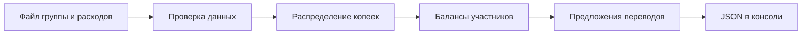
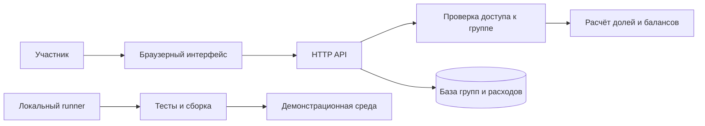

# Архитектура и алгоритм

## Прототип



## Целевая архитектура квартального релиза



Вторая схема — **план**, а не описание уже поднятой системы.

## Формулы

Для участника $i$ итоговый баланс:

$$B_i = P_i - S_i$$

где $P_i$ — оплаченная им сумма, $S_i$ — его доля общих расходов.

Инвариант:

$$\sum_{i=1}^{n} B_i = 0$$

Для суммы $A$ копеек и $n$ участников:

$$q = \lfloor A/n \rfloor, \qquad r = A \bmod n$$

Первые $r$ участников получают долю $q+1$, остальные — $q$ копеек.
Порядок берётся из списка участников расхода; поэтому повторный расчёт детерминирован.

## Взаиморасчёты

Должники и кредиторы сортируются по убыванию суммы, при равенстве — по имени.
Берётся текущая пара и переводится минимум из двух остатков. Как только остаток
одной стороны равен нулю, алгоритм переходит к следующему участнику.

Алгоритм погашает балансы за не более чем $n-1$ переводов, если есть задолженность.
Глобально минимальное число переводов **не гарантируется**. Реальные переводы
между банками не выполняются.

## Пример входа

```json
{
  "members": ["Аня", "Борис"],
  "expenses": [
    {"payer": "Аня", "amount_kopecks": 10001, "participants": ["Аня", "Борис"]}
  ]
}
```

Доли: Аня 5001 коп., Борис 5000 коп. Борис должен Ане 5000 коп.

## Контракт будущего API

| Метод | Ресурс | Назначение |
|---|---|---|
| POST | `/groups` | Создать группу |
| POST | `/groups/{id}/expenses` | Добавить расход |
| GET | `/groups/{id}/balances` | Получить балансы и предложения переводов |
| POST | `/groups/{id}/settlements` | Подтвердить возврат с ключом идемпотентности |

До начала интеграции команды согласуют JSON-схемы, ошибки и правила доступа
в задаче SS-01. Изменение контракта после согласования требует обсуждения Backend и Frontend.
