# Тестирование и сборка

```mermaid
flowchart LR
    Source[Публичный splitshare] --> Review[Проверка конкретного коммита]
    Review --> Copy[Ручной перенос разрешённых файлов]
    Copy --> Private[Приватный splitshare-ci и SOURCE.json]
    Private --> Manual[Ручной запуск на main]
    Manual --> Runner[Mac splitshare-private-mac]
    Runner --> Tests[18 тестов]
    Tests --> Build[Сборка splitshare.pyz]
    Build --> Smoke[Запуск JSON и текстового отчёта]
    Smoke --> Artifact[Артефакт splitshare-app]
```



Основной репозиторий не имеет зарегистрированного runner и активного workflow. Автоматической передачи публичных PR в приватный CI нет. Копия исходников переносится после проверки конкретного коммита; SHA исходника и контрольные суммы файлов фиксируются в `SOURCE.json`.

В приватном `eductionnn-netizen/splitshare-ci` workflow использует `workflow_dispatch`, проверяет имя репозитория и ветку `main`, затем назначает задание runner с меткой `splitshare-private`. Права токена ограничены чтением исходников. Постоянный автозапуск runner не установлен.

## Проверки

```bash
python3 -m unittest discover -s tests -v
python3 scripts/build.py
python3 scripts/smoke.py
python3 dist/splitshare.pyz examples/weekend.json --format text
```

Проверяются расчёт балансов, распределение остаточных копеек, неверные входные данные, CLI, текстовый отчёт и исполнение собранного архива. Результат примера: Вика → Аня 1300.00 ₽; Борис → Аня 400.00 ₽.

## Обновление и запуск

[Процедура обновления приватной копии](https://github.com/eductionnn-netizen/splitshare/blob/main/ci/README.md). Владелец открывает Actions приватного репозитория, выбирает SplitShare private local CI и запускает Run workflow на main. После работы runner останавливается. Логи приватного CI доступны только его участникам.

CI запускает тесты и собирает исполняемый архив приложения. Постоянное развёртывание веб-сервиса пока не реализовано.
