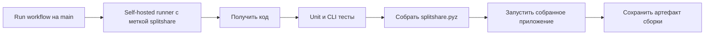

# CI/CD на локальном компьютере

## Подготовленная линия



Файл: `.github/workflows/ci.yml`. Используется `runs-on: [self-hosted, splitshare]`.
Сборка и тесты исполняются на зарегистрированном компьютере; GitHub хранит исходники,
управляет заданием и принимает артефакт. Workflow запускается вручную только на `main`.

Этот комплект реализует CI и выдачу готового артефакта. Постоянное автоматическое
развёртывание веб-сервиса ещё не реализовано. Для требования «показать запущенный
проект» выполняется собранная консольная программа с проверкой результата.

## Локальная проверка без регистрации runner

Из корня проекта:

```bash
python3 -m unittest discover -s tests -v
python3 scripts/build.py
python3 scripts/smoke.py
```

Запуск этих команд подтверждает локальные тесты и сборку, но сам по себе
не подтверждает успешный запуск GitHub Actions.

## Подключение self-hosted runner

1. Создать репозиторий и загрузить проект, сохранив основную ветку `main`.
2. Открыть **Settings → Actions → Runners → New self-hosted runner**.
3. Выбрать ОС и архитектуру компьютера. Нужен установленный Python 3.9+.
4. Выполнить актуальные команды скачивания и регистрации, показанные GitHub.
5. При регистрации добавить пользовательскую метку `splitshare`.
6. Запустить runner командой `./run.sh` и убедиться, что он Online/Idle.
7. В Actions открыть **SplitShare local CI → Run workflow**, выбрать `main`.
8. Проверить имя runner, зелёные шаги тестов и smoke, скачать `splitshare-app`.
9. Для показа результата запустить `python3 dist/splitshare.pyz examples/weekend.json`.

Регистрационный токен берётся из настроек репозитория и не сохраняется в wiki,
исходниках или скриншотах. Каталог runner размещается вне исходников проекта.

## Выбор репозитория

GitHub рекомендует self-hosted runner для приватных репозиториев. При этом wiki
приватного репозитория требует соответствующего платного плана. Если доступен
только GitHub Free, можно отдельно разместить публичную учебную wiki, оставив
исполняемый код и runner в приватном репозитории. Код опубликован в приватном eductionnn-netizen/splitshare, Wiki — в публичном splitshare-docs.

Workflow не подписан на pull request из внешних fork. Доступ к изменению кода
и ручному запуску выдаётся только согласованным участникам учебного проекта.

## Что показать преподавателю

- Runner в состоянии Online/Idle и его имя.
- Запуск workflow на том же runner, с конкретным commit SHA.
- Успешные тесты и `SMOKE PASSED`.
- Артефакт `splitshare.pyz` и его исполнение на компьютере.

## Документация GitHub

- [Добавление self-hosted runner](https://docs.github.com/en/actions/how-tos/manage-runners/self-hosted-runners/add-runners)
- [Доступность wiki](https://docs.github.com/en/communities/documenting-your-project-with-wikis/about-wikis)
- [Синтаксис workflow](https://docs.github.com/en/actions/reference/workflows-and-actions/workflow-syntax)

## Фактический результат 22.10.2026

[Workflow](https://github.com/eductionnn-netizen/splitshare/actions/runs/39808522101) завершён со статусом **completed / success** на локальном Mac, runner `splitshare-mac-arm64`.
Commit: `5aa01ac0b10431cd1bb3c78d21b54a300f51ad26`.
Все 15 тестов пройдены; архив `splitshare.pyz` собран и выполнен, результат `SMOKE PASSED`. Артефакт `splitshare-app` опубликован в Actions. Постоянный автозапуск runner не установлен.
