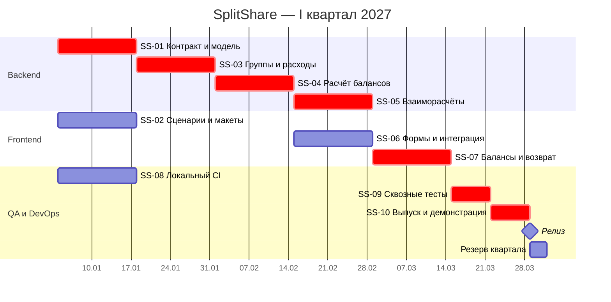

# Квартальный план: I квартал 2027

Плановый горизонт: январь–март 2027. Это будущий учебный план, а не история выполненных спринтов.
Шесть спринтов с 4 января по 28 марта; 1–3 января — подготовка, 29–31 марта — резерв.
Спринты — календарные двухнедельные интервалы. Рабочую ёмкость S1 нужно уменьшить
с учётом праздников и доступности участников; официальные рабочие дни здесь не рассчитываются.

## Цель квартала

Дать группе друзей возможность создать общую группу, записать расходы, увидеть
балансы и подтвердить возврат долга в браузере. Критерий выпуска: сквозной сценарий
для трёх участников проходит в локальной демонстрационной среде, все обязательные тесты зелёные.

| Спринт | Даты | Общий результат | Задачи |
|---|---|---|---|
| S1 | 04.01–17.01 | Контракт, интерфейсные сценарии и основа CI | SS-01, SS-02, SS-08 |
| S2 | 18.01–31.01 | Хранение групп и расходов | SS-03 |
| S3 | 01.02–14.02 | Расчёт балансов через API | SS-04 |
| S4 | 15.02–28.02 | Интегрированные формы и взаиморасчёты | SS-05, SS-06 |
| S5 | 01.03–14.03 | Экран балансов и подтверждение возврата | SS-07 |
| S6 | 15.03–28.03 | Сквозные тесты, исправления, выпуск | SS-09, SS-10 |

## Диаграмма Ганта

Конец бара в Mermaid — граница следующего дня: бар на 14 дней от 04.01 соответствует
работе 04.01–17.01. Расписание учитывает зависимости, но не загрузку полной команды:
в свободных интервалах — ревью, поддержка интеграции и исправления, без выдуманных задач.

## Межкомандные зависимости

| Поставщик → потребитель | Что передаётся | Нужно к | Ответственный за контроль | Условие закрытия |
|---|---|---|---|---|
| Backend SS-01 → Frontend SS-06 | Схемы API и примеры ошибок | 18.01 | Frontend lead | Контракт согласован; доступны mock-ответы |
| Frontend SS-02 → Backend SS-03 | Поля формы и состояния ошибок | 18.01 | Backend lead | Поля отражены в контракте |
| Backend SS-03/04 → Frontend SS-06 | Работающие endpoints расходов и балансов | 15.02 | Frontend lead | Контрактные проверки зелёные |
| Backend SS-05 → Frontend SS-07 | Предложения переводов и подтверждение возврата | 01.03 | Frontend lead | Повтор подтверждения не создаёт второй перевод |
| Frontend SS-07 → QA SS-09 | Интегрированный сценарий | 15.03 | QA lead | Демо создания расхода и возврата проходит |
| QA/DevOps SS-08 → все команды | Доступная линия тестов и сборки | 18.01 | DevOps lead | Есть успешный запуск на локальном runner |
| QA SS-09 → выпуск SS-10 | Результаты сквозных проверок | 22.03 | Product Owner | Нет открытых блокирующих дефектов |

## Как управляем зависимостями

В карточке храним `Depends on`, команду-поставщика, ожидаемую дату и ссылку на
результат. На Scrum of Scrums проверяем приближающиеся сроки. Если поставка
задерживается, ставим `blocked`, согласуем обход через mock или переносим зависимую
задачу и обновляем Гант. Mock позволяет продолжить UI, но не закрывает интеграцию.

Критическая цепочка: SS-01 → SS-03 → SS-04 → SS-05 → SS-07 → SS-09 → SS-10.
Параллельная SS-06 тоже должна завершиться до SS-07. Трёхдневный резерв не покрывает
срыв целого спринта: в таком случае уменьшаем объём релиза или меняем дату.

## Риски

| Риск | Реакция |
|---|---|
| Изменился контракт API | Согласовать версию и обновить контрактные тесты до интеграции |
| Ошибки округления | Целые копейки, проверки сохранения суммы и нулевого общего баланса |
| Runner выключен | Запланированное окно демонстрации, проверка доступности заранее |
| Не хватает времени в S1 | Сократить макеты до одного основного сценария, сохранить контракт и CI |
