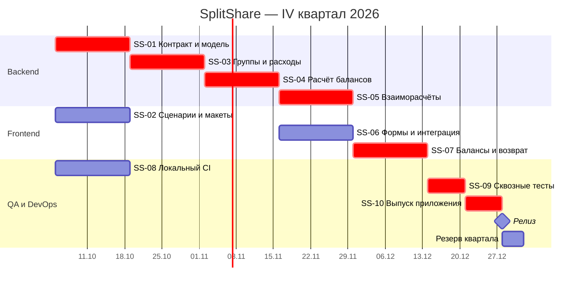
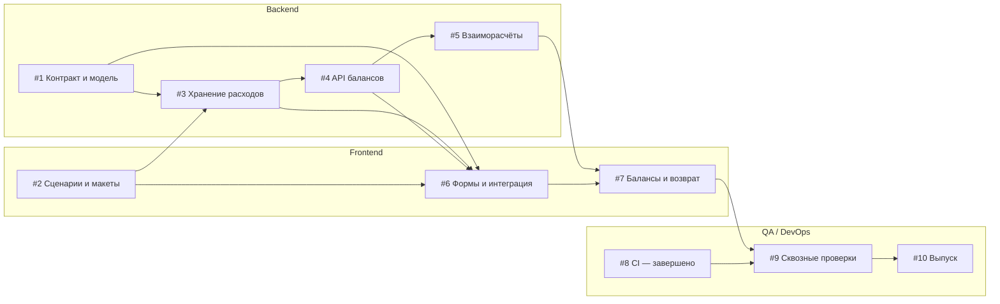

# Квартальный план: IV квартал 2026

План охватывает октябрь–декабрь 2026 года и включает шесть двухнедельных спринтов.
Основные работы запланированы с 5 октября по 27 декабря. На подготовку отведено
1–4 октября, на резерв по срокам — 28–31 декабря.
Объём работ на спринт уточняется с учётом доступности участников.

## Цель квартала

Дать группе друзей возможность создать общую группу, записать расходы, увидеть
балансы и подтвердить возврат долга в браузере. Условия выпуска: сценарий для трёх участников работает в локальной среде,
все обязательные тесты завершаются успешно.

| Спринт | Даты | Общий результат | Задачи |
|---|---|---|---|
| S1 | 05.10–18.10 | Контракт, интерфейсные сценарии и основа CI | SS-01, SS-02, SS-08 |
| S2 | 19.10–01.11 | Хранение групп и расходов | SS-03 |
| S3 | 02.11–15.11 | Расчёт балансов через API | SS-04 |
| S4 | 16.11–29.11 | Интегрированные формы и взаиморасчёты | SS-05, SS-06 |
| S5 | 30.11–13.12 | Экран балансов и подтверждение возврата | SS-07 |
| S6 | 14.12–27.12 | Сквозные тесты, исправления, выпуск | SS-09, SS-10 |

## Диаграмма Ганта

Начало и окончание периода каждой задачи указаны в Roadmap. Даты включают первый
и последний день работы: например, первый спринт длится с 5 по 18 октября.

## Зависимости между задачами

Стрелка показывает порядок выполнения: следующая задача зависит от результата предыдущей.
Связи между задачами сохранены в GitHub Issues. Задача #8 по настройке CI завершена.

### Последовательность подзадач

| Основная задача | Первая подзадача | Зависимая подзадача | Интервал 2026 |
|---|---|---|---|
| #3 | [#12 Схема хранения](https://github.com/eductionnn-netizen/splitshare/issues/12) | [#13 API и доступ](https://github.com/eductionnn-netizen/splitshare/issues/13) | 19.10–01.11 |
| #6 | [#14 Формы](https://github.com/eductionnn-netizen/splitshare/issues/14) | [#15 Интеграция](https://github.com/eductionnn-netizen/splitshare/issues/15) | 16.11–29.11 |
| #9 | [#16 Сквозной сценарий](https://github.com/eductionnn-netizen/splitshare/issues/16) | [#17 Ошибки и повтор](https://github.com/eductionnn-netizen/splitshare/issues/17) | 14.12–20.12 |

В каждой паре вторая подзадача начинается после завершения первой. Этот порядок задан
связью Blocked by. Оценка основной задачи включает трудоёмкость её подзадач.

## Межкомандные зависимости

| Поставщик → потребитель | Что передаётся | Нужно к | Ответственный за контроль | Условие закрытия |
|---|---|---|---|---|
| Backend SS-01 → Frontend SS-06 | Схемы API и примеры ошибок | 19.10 | руководитель Frontend | Контракт согласован; подготовлены тестовые ответы API |
| Frontend SS-02 → Backend SS-03 | Поля формы и состояния ошибок | 19.10 | руководитель Backend | Поля отражены в контракте |
| Backend SS-03/04 → Frontend SS-06 | Методы API расходов и балансов | 16.11 | руководитель Frontend | Контрактные тесты проходят |
| Backend SS-05 → Frontend SS-07 | Предложения переводов и подтверждение возврата | 30.11 | руководитель Frontend | Повтор подтверждения не создаёт второй перевод |
| Frontend SS-07 → QA SS-09 | Интегрированный сценарий | 14.12 | руководитель QA | Сценарий создания расхода и возврата работает |
| QA/DevOps SS-08 → все команды | Настроенные тесты и сборка | 19.10 | руководитель DevOps | Есть успешный запуск на локальном runner |
| QA SS-09 → выпуск SS-10 | Результаты сквозных проверок | 21.12 | владелец продукта | Нет открытых блокирующих дефектов |

## Как управляем зависимостями

Зависимости указываются в разделе Relationships карточки задачи: Blocked by — от каких
задач она зависит, Blocking — какие задачи зависят от неё. В описании фиксируются
ответственная команда, срок передачи результата и ссылка на него.

На встречах Scrum of Scrums команды проверяют сроки передачи результатов. При задержке
согласуют новый срок и обновляют Roadmap и диаграмму Ганта. Разработку интерфейса можно
продолжить с тестовыми ответами API; интеграционные проверки выполняются с работающим API.

Критическая цепочка: SS-01 → SS-03 → SS-04 → SS-05 → SS-07 → SS-09 → SS-10.
Параллельная SS-06 тоже должна завершиться до SS-07. Четырёхдневный резерв не покрывает
срыв целого спринта: в таком случае уменьшаем объём релиза или меняем дату.

## Риски

| Риск | Реакция |
|---|---|
| Изменился контракт API | Согласовать версию и обновить контрактные тесты до интеграции |
| Ошибки округления | Целые копейки, проверки сохранения суммы и нулевого общего баланса |
| Runner выключен | Проверить доступность runner перед запуском сборки |
| Не хватает времени в S1 | Сократить макеты до одного основного сценария, сохранить контракт и CI |

## Roadmap

[Интерактивный Roadmap](https://github.com/users/eductionnn-netizen/projects/1/views/4) содержит 10 основных задач и 6 подзадач с полями Start date и Target date.
[Таблица с иерархией](https://github.com/users/eductionnn-netizen/projects/1/views/6) показывает основные задачи, подзадачи и их выполнение.
В Roadmap значок блокировки открывает связанную карточку; полный список находится в Relationships.
CI настроен 22.10.2026. С 23.10.2026 доступна локальная версия с веб-интерфейсом, SQLite и API групп и расходов. Аккаунты, совместный доступ и подтверждение возвратов остаются в плане. Критерии приёмки задач по многопользовательской версии проверяются отдельно.

